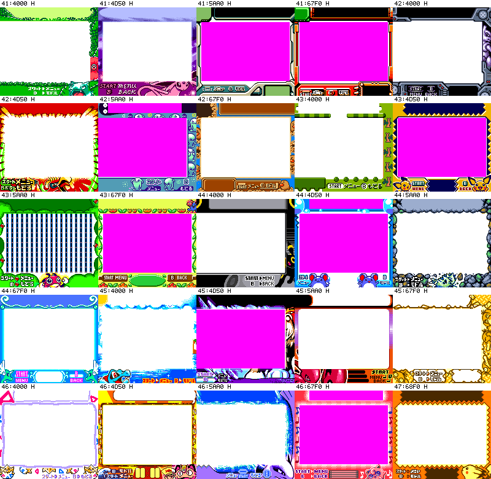
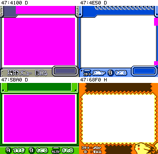

# Pokémon graphic windows and name-table limits

## Byte facts and model provenance

Bank 53:4000 contains 25 little-endian pointers (50 bytes) followed by25 Shift-JIS/NUL strings (319 bytes), ending4171. Own decode/reemit reproduces all 369 bytes. The maintained table/header's “no reader found” is a finite historical statement, not proof of no computed reader.

The bank 41–46 loop describes24 physical windows of stride 0D50. A further window47:68F0–7640 has 2560 tile bytes, 360 tilemap bytes at72F0,360 attributes at7458 and 128 palette bytes at75C0. Its current editable PNG already exists: `gfx/browser/frames_2_3/tilemap_72f0.screen.png`. All 360 cells select bank 1 with tile number below 128; the declared 160-unsigned and 128-signed models select the same byte/palette sources for every cell, and the existingPNG matches the own model in all 23,040 RGB pixels. This proves conditional composition identity, not an executed loader.

The 27-style table4E:654B selects five 31-byte descriptors but only three distinct sets of five far pointers, all in bank 47 (record starts4100/4E50/5BA0). It does not select 68F0, point into bank 41–46 or reference the bank 53 name table. The physical fourth record remains HYPOTHESIS. Its visual identity remains unproved; no species name or image/name mapping is adopted from visual resemblance. The counts 25 names and 24+1 windows neither establish a bijection nor shared order.

## Locator-only contacts

The first 24 cards use the 160-tile editing model, with unresolved cells pink. The last card is 47:68F0. Card order is address order, not name-table order or a menu order.

D marks the first three windows selected by maintained descriptors; H marks 47:68F0, outside that table. These images use the 128 BG signed/menu/32OBJ model; unprovided cells are pink. D describes static pointer/load provenance, not CONFIRMED natural reachability.

## Name-table order, no image assignment

| index | address | Shift-JIS text | image assignment |
|---:|---|---|---|
|0|53:4032|　　ポリゴン|unproved|
|1|53:403F|　ピカチュウ|unproved|
|2|53:404C|　　トゲピー|unproved|
|3|53:4059|　　ニャース|unproved|
|4|53:4066|　　ルギア|unproved|
|5|53:4071|　　プリン|unproved|
|6|53:407C|　　ワニノコ|unproved|
|7|53:4089|　　エンテイ|unproved|
|8|53:4096|　　ハッサム|unproved|
|9|53:40A3|　　コダック|unproved|
|10|53:40B0|　ブラッキー|unproved|
|11|53:40BD|　　マリル|unproved|
|12|53:40C8|　バンギラス|unproved|
|13|53:40D5|　ハクリュー|unproved|
|14|53:40E2|　ウソッキー|unproved|
|15|53:40EF|　　ピチュー|unproved|
|16|53:40FC|　　レディバ|unproved|
|17|53:4109|　キレイハナ|unproved|
|18|53:4116|　ミュウツー|unproved|
|19|53:4123|　　ホウオウ|unproved|
|20|53:4130|　ソーナンス|unproved|
|21|53:413D|　　ディグダ|unproved|
|22|53:414A|　フシギバナ|unproved|
|23|53:4157|　　エーフィ|unproved|
|24|53:4164|　ポリゴン２|unproved|

## Finite consumer confrontation

Own 343 ASM + 5 INC source scan finds Table_53_4000 only at its definition; String_53_4032 occurs at its definition and the first dw in the same table. No BANK expression of a current bank 53 symbol was found. Six literal `ld a,$53` sites immediately store to hTextY (account/confirm_screens:514) or wSpriteSlot2 (browser/page_list:685/880/894/2216/2578); those six instructions do not select ROM bank 53. Three adjacent exact ROM patterns2100403e53,3e53210040,004053 had zero matches. These observations cover only their stated source/symbol/pattern scope. They do not exclude arithmetic, delayed bank changes, computed pointers, runtime copying or unobserved paths. No missing callergraph was reconstructed and no new natural scenario was captured.

Keep image/name assignment, purpose of unused layouts and natural reachability HYPOTHESIS. A missing preview, fragmentary tile extraction or absent literal pattern must not be promoted to a missing ROM resource. All 947 active assets already reproduce original bytes; this audit changes only documentation and the two explanatory contacts. Actual integration, later publication and any new runtime evidence are separate ROOT operations.

## Descriptor suffix consumers and composition limits

The following is a PROBABLE static consumer derivation from the original bank 4E bytes and maintained source. It qualifies the conditional image models above; it does not add a natural observation or change any storage status. Descriptor 1 at 65A0 retains its separately documented CONFIRMED evidence: all31 bytes were read collectively across15 historical natural scenarios; this is not a claim that each call reads all31 bytes. The other four descriptors retain their current PROBABLE headers.

The five descriptors at 6581/65A0/65BF/65DE/65FD have the same 31-byte layout. Their first 15 bytes are five address/bank triples; all source banks are 47. The following 16 bytes contain three WRAM7 map destinations and five X/Y pairs, rather than more far pointers. Values below are hexadecimal; each row is two bytes.

| offset | field | original values across the five descriptors | consumers and first read sites in ROM4E |
|---|---|---|---|
| 0F | body-map destination | D061 in all five | ClearBodyArea 612B: read6141; ReloadFrameTilemap: read5DAF; preview reads6347/64B3 |
| 11 | title-map destination | D004 at6581/65A0/65FD; D002 at65BF/65DE | ClearTitleArea 60E4: read60FA; ReloadFrameTilemap: read5DE6; preview reads637D/64F9 |
| 13 | up-arrow X,Y | 48,10 in all five | ShowUpArrow 5F58: read5F8C |
| 15 | down-arrow X,Y | 48,78 in all five | DrawScrollIndicators 5EC0: read5F2B |
| 17 | timer X,Y before reader adds08/10 | 70,80 at6581/65A0; 71,7A at65BF/65DE; 70,7E at65FD | DrawCommTimer 5FB9: read5FEB |
| 19 | connection-icon X,Y | 08,00 at6581/65A0; 84,00 at65BF/65DE; 00,00 at65FD | ConnIcon_StartSprite 604C: read607E; unproved-entry getter6087: read609F |
| 1B | scrollbar-map destination | D073 in all five | DrawScrollbarTrack 5E11: read5E32 |
| 1D | scroll-thumb X,Y base | 98,18 in all five | UpdateScrollThumb 5E5B: read5E76 |

`Browser_LoadFrameGraphics` at6196–6291 directly consumes only offsets00–0E, but its complete call path also uses suffix fields. Its calls at625F/6265/626B target ClearBodyArea612B, ClearTitleArea60E4 and DrawScrollbarTrack5E11. The first two read0F/11 and fill map rectangles through4F:45C6; they also clear the body/title tile canvases through4F:4604. The track helper returns early if the scrollbar is disabled. Its enabled path reads1B, writes the track and attributes in WRAM7, and falls directly from the loop ending5E5A into UpdateScrollThumb5E5B, which conditionally reads1D. Consequently “MAIN reads only15 bytes” is valid only for the direct6196–6291 body, not its full helper path. Arrow, timer and connection-icon consumers are additional routines; this does not claim they are all invoked by that loader.

All descriptor table reads above require ROM4E mapped. FarCall00:06D1 saves and restores the caller ROM bank around its inline target; resource transfers temporarily select the bank47 sources. Tilemap_FillAscendingWithAttr4F:45C6 explicitly selects WRAM7 and restores its incoming WRAM bank. DrawScrollbarTrack explicitly selects WRAM7; TileCanvas_FillRect4F:4604 instead writes tile staging banks2/3 and restores its incoming WRAM bank. These destination effects must not be confused with descriptor or source-ROM banks.

`Browser_FrameStylePreview_LoadGraphics` at6291–6543 has four direct suffix queries, all to0F/11. They use two selectors in distinct phases:

Rectangle dimensions in the next table are decimal; attributes, tile starts, addresses and offsets are hexadecimal.

| phase | selector | offset/read site | map fills |
|---|---|---|---|
| before SRAM3 snapshot | hFramePreview_Style | 0F/6347 | 5x18 at destination and7x18 at destination+A0; attribute04, tile starts20/80 |
| before SRAM3 snapshot | hFramePreview_Style | 11/637D | two1x15 rows at destination and destination+20; attribute01, tile starts00/0F |
| after tile-bit and attribute remapping | wBrowserFrameStyle | 0F/64B3 | same body geometry; attribute07, tile starts20/80 |
| after tile-bit and attribute remapping | wBrowserFrameStyle | 11/64F9 | same title geometry; attribute00, tile starts00/0F |

The first pair precedes the0800-byte WRAM7 map snapshot to SRAM3:B000. The later pair follows the6477 tile-bit loop and6486 attribute lookup. The latter body phase also fills the body canvas withFFFF; the title phase clears its canvas with0000 before the final uploads. This routine does not directly consume every byte of the16-byte suffix. Its maintained PROBABLE status and forced-only evidence remain unchanged.

The MAIN placement and PREVIEW pair pixel models are conditional fixtures for their declared transfers and map choices. They do not model all helper map/canvas mutations, uploads, sprites or reveal steps, and are not full-procedure predictions. The complete47:68F0 editing PNG still matches its own declared composition in23040 RGB pixels; that physical record is absent from the three far-pointer sets selected by the27 words. None of these facts supplies an observed LCDC mode, a species assignment, an image/name order or natural reachability for the fourth record.

The finite69-scenario coverage union records execution of the MAIN first-pointer reader61DD and the named body/title/track/thumb readers, while the four preview suffix readers have no rows. This instruction metadata does not identify which descriptor supplied a given read, reestablish whole-descriptor data coverage, or prove absence of other paths. The existing descriptor1 natural-data-read result remains the separate authority for its CONFIRMED header.

Verification, 2026-10-11: the private candidate and the actual MAIN checkout each completed the canonical37 profile (36 checks rc0; the documented ordinal27 negative case rc2 with its exact97-byte diagnostic). All4246 source files held during each run, and all671 build outputs matched the newly reconstructed d6a01a0 baseline byte for byte. `make` reported SHA-256 OK / RESULT: IDENTICAL; symbol and palette checks passed. This pass changes documentation only. No new runtime capture, species association, natural-reachability or hardware claim is made.
