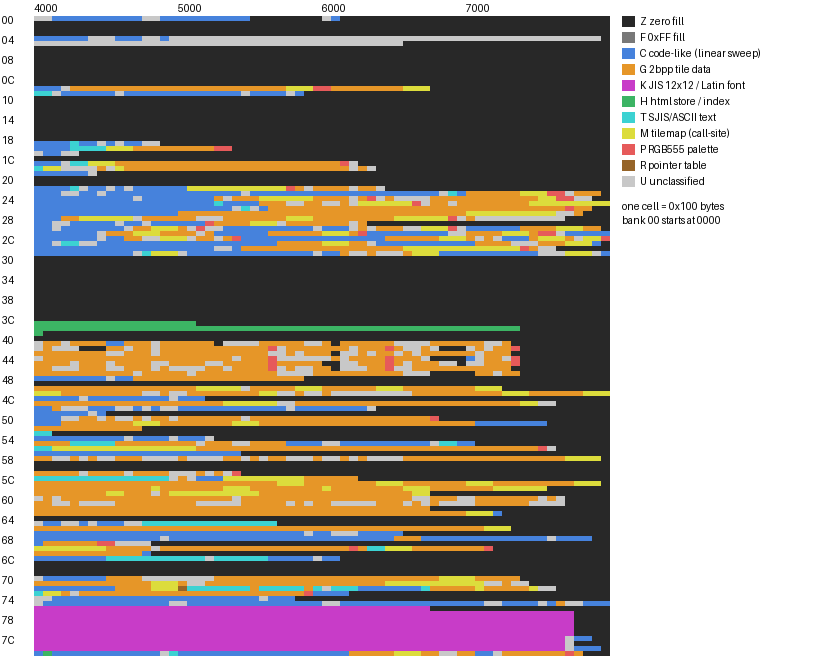

# Bank survey (generated by `tools/survey.py`)

**Addresses (`bank:addr`) remain valid**: find the code with `grep -rn '; BB:AAAA' --include=*.asm .` or in `build/mobile_trainer.sym`.

Evidence vocabulary: **CONFIRMED** = demonstrated by cited bytes/disassembly; **PROBABLE** = strong evidence, not conclusive; **HYPOTHESIS** = interpretation not yet confirmed. Heuristic classifications (code-likeness, tile coherence) are never better than PROBABLE; after adversarial review heuristic tile blocks need >= 32 coherent tiles for PROBABLE and heuristic proposals are trimmed against recursively-proven code.

* **Windows / blocks**: every bank is analysed in 4 windows of 0x1000 bytes (`windows` in the JSON) and 64 blocks of 0x100 bytes (`block_map`).

* **Code-likeness**: linear SM83 sweep with `tools/sm83.py`; per window/block the fraction of illegal opcodes, the density of `ret/jp/jr` terminators, the fraction of absolute `call/jp` targets that are valid (ROM0 instruction starts, in-bank instruction starts, WRAM C000-DFFF, HRAM) and a log-likelihood ratio (`llr`, bits/instruction) of the opcode stream against an opcode model trained on the bank-00 code stream.

* **Palettes**: 4-word groups with bit 15 clear, >= 3 distinct values, containing $7FFF and monotone luminance (chance < 1e-5 per offset); consecutive groups form runs.

## 3. Per-bank map

Legend: `Z` zero fill, `F` 0xFF fill, `C` code-like (linear sweep), `G` 2bpp tile data, `K` JIS 12x12 / Latin font, `H` html store / index, `T` SJIS/ASCII text, `M` tilemap (call-site), `P` RGB555 palette, `R` pointer table, `U` unclassified. Each map character is one 0x100-byte block (first char = 4000 or 0000).

| bank | used end | byte classes (>=5%) | strings (C/P/H) | tables | palettes | notes |
|---|---|---|---|---|---|---|
| 00 | 2183 | Z 63%, C 31%, U 6% | 0/0/0 | 0 | 1 | reset/interrupt vectors, text engine (0ED3), far-call helper (06D1), HDMA/tilemap loaders (0787/08EA), boot palette 0352 |
| 04 | 7E8C | U 82%, C 16% | 0/0/0 | 1 | 0 | APU init at 4056 => probable sound driver (PROBABLE); rest unclassified |
| 05 | 68C3 | U 63%, Z 36% | 0/0/12 | 0 | 0 | unclassified; 63B0 mixes commands with SJIS pairs (not proven sound data) |
| 0E | 6BB0 | G 51%, Z 32%, M 9% | 0/0/0 | 1 | 2 |  |
| 0F | 5DAE | Z 54%, C 37%, U 7% | 0/22/1 | 0 | 0 | mail header strings |
| 19 | 4D99 | Z 79%, C 14% | 0/4/1 | 0 | 1 |  |
| 1A | 55D4 | Z 66%, G 14%, C 6% | 9/40/6 | 4 | 1 |  |
| 1B | 446B | Z 93% | 0/1/1 | 0 | 1 |  |
| 1C | 4033 | Z 100% | 0/0/0 | 0 | 0 |  |
| 1D | 63BA | Z 44%, G 37%, U 5% | 8/6/0 | 2 | 3 |  |
| 1E | 658B | Z 41%, G 41%, U 9%, M 5% | 3/1/2 | 12 | 1 |  |
| 1F | 4667 | Z 90%, C 9% | 0/0/0 | 0 | 0 |  |
| 22 | 66CF | Z 40%, C 20%, M 18%, U 10%, G 9% | 4/3/0 | 0 | 1 |  |
| 23 | 7F30 | C 65%, G 15%, U 8% | 4/7/0 | 0 | 1 |  |
| 24 | 7D48 | G 33%, C 30%, U 14%, M 13% | 0/12/1 | 4 | 3 |  |
| 25 | 7FA0 | C 37%, G 27%, M 22%, U 11% | 4/1/0 | 0 | 2 |  |
| 26 | 7D41 | G 52%, C 36% | 1/8/0 | 0 | 2 |  |
| 27 | 7CE4 | G 51%, C 25%, M 14% | 0/0/0 | 0 | 1 |  |
| 28 | 7A5D | G 41%, U 23%, M 22%, Z 9% | 0/0/0 | 2 | 4 |  |
| 29 | 64F4 | Z 44%, C 23%, G 17%, U 9% | 6/2/0 | 0 | 3 |  |
| 2A | 7E78 | C 43%, G 21%, U 17%, M 13% | 0/8/0 | 1 | 4 |  |
| 2B | 7F44 | C 41%, G 29%, M 13%, U 10% | 3/3/0 | 0 | 5 |  |
| 2C | 7FD0 | C 44%, G 23%, M 18%, U 11% | 0/3/0 | 1 | 6 |  |
| 2D | 7ECD | C 51%, G 22%, U 11%, M 9% | 2/23/2 | 0 | 2 |  |
| 2E | 7961 | C 32%, G 30%, M 19%, Z 10% | 3/3/0 | 0 | 1 |  |
| 2F | 7FAC | C 60%, U 18%, M 13%, G 6% | 4/3/0 | 0 | 2 |  |
| 3D | 518B | Z 73%, H 27% | 13/0/0 | 0 | 0 | html store (13 files) |
| 3E | 75CE | H 84%, Z 16% | 42/0/0 | 0 | 0 | html store (42 files) |
| 3F | 410C | Z 98% | 0/0/0 | 0 | 0 | html far-pointer index |
| 41 | 753E | G 48%, Z 24%, U 23% | 0/0/0 | 2 | 7 |  |
| 42 | 753D | G 46%, Z 28%, U 23% | 0/0/1 | 0 | 5 |  |
| 43 | 7540 | G 58%, Z 21%, U 19% | 0/0/0 | 0 | 6 |  |
| 44 | 7540 | G 51%, Z 26%, U 18% | 0/0/0 | 1 | 6 |  |
| 45 | 753D | G 49%, Z 27%, U 21% | 0/0/0 | 0 | 4 |  |
| 46 | 7540 | G 51%, U 25%, Z 21% | 0/0/0 | 1 | 4 |  |
| 47 | 763E | G 58%, Z 23%, U 16% | 0/0/0 | 0 | 4 |  |
| 48 | 5DC9 | Z 53%, G 30%, C 15% | 0/0/1 | 0 | 0 |  |
| 4A | 7378 | G 57%, M 21%, Z 20% | 0/0/0 | 0 | 1 |  |
| 4B | 7FE0 | G 58%, U 24%, M 18% | 0/0/0 | 0 | 1 |  |
| 4C | 52DF | Z 71%, C 26% | 0/0/0 | 0 | 0 |  |
| 4D | 7983 | G 71%, M 13%, Z 10%, U 5% | 0/0/0 | 2 | 0 |  |
| 4E | 661C | C 42%, Z 40%, U 15% | 0/0/0 | 0 | 0 |  |
| 4F | 47FD | Z 88%, C 11% | 0/0/0 | 0 | 0 |  |
| 50 | 6D1E | G 49%, Z 30%, U 16% | 0/0/0 | 1 | 1 |  |
| 51 | 7900 | G 62%, C 17%, Z 11%, M 9% | 0/0/0 | 0 | 3 |  |
| 52 | 4BFF | Z 82%, G 18% | 0/0/0 | 0 | 1 |  |
| 53 | 4170 | Z 98% | 0/25/0 | 1 | 0 |  |
| 54 | 53E9 | Z 69%, C 26% | 1/2/1 | 0 | 0 |  |
| 55 | 7082 | G 29%, Z 25%, C 24%, U 14%, T 8% | 12/36/15 | 1 | 1 |  |
| 56 | 79D0 | G 58%, M 26%, Z 10% | 6/0/0 | 1 | 2 |  |
| 57 | 5641 | Z 65%, C 35% | 0/0/0 | 0 | 0 |  |
| 58 | 7EA0 | G 52%, U 41% | 0/0/0 | 0 | 1 |  |
| 5B | 56E0 | Z 64%, G 21%, U 12% | 0/0/0 | 0 | 1 |  |
| 5C | 642F | Z 43%, T 24%, M 13%, G 11% | 28/8/0 | 2 | 3 | error message texts |
| 5D | 7E70 | G 79%, M 18% | 0/0/0 | 0 | 2 |  |
| 5E | 78A0 | G 68%, M 20%, Z 12% | 0/0/0 | 0 | 0 |  |
| 5F | 6BCE | G 45%, Z 32%, M 22% | 0/0/0 | 1 | 2 |  |
| 60 | 7AE8 | G 67%, U 22%, Z 8% | 0/0/0 | 0 | 5 |  |
| 61 | 7AE8 | G 46%, U 41%, Z 8% | 0/0/0 | 0 | 3 |  |
| 62 | 6C00 | G 69%, Z 31% | 0/0/0 | 0 | 0 |  |
| 63 | 742F | G 75%, Z 18% | 0/0/0 | 1 | 1 |  |
| 65 | 5A8C | Z 59%, T 22%, U 11%, C 9% | 22/22/0 | 0 | 0 | CR-terminated Shift-JIS help text |
| 66 | 74B8 | G 77%, Z 18% | 0/0/0 | 0 | 0 |  |
| 67 | 685F | C 57%, Z 37%, U 6% | 0/4/0 | 1 | 0 |  |
| 68 | 7D8D | C 88% | 0/4/0 | 5 | 0 |  |
| 69 | 4C46 | Z 81%, G 9%, U 6% | 0/0/0 | 2 | 1 |  |
| 6A | 72BF | G 51%, Z 21%, M 18% | 12/6/1 | 1 | 5 |  |
| 6B | 4D20 | Z 81%, G 18% | 0/0/0 | 0 | 0 |  |
| 6C | 61CB | Z 47%, C 23%, T 21%, U 9% | 0/70/26 | 0 | 0 |  |
| 70 | 7590 | G 52%, Z 16%, U 14%, C 11%, M 5% | 0/0/0 | 7 | 0 |  |
| 71 | 7740 | G 56%, M 22%, Z 14%, U 8% | 0/0/0 | 0 | 1 |  |
| 72 | 7A1F | G 28%, C 25%, T 19%, U 10%, Z 9%, M 8% | 65/30/1 | 1 | 2 | Shift-JIS message records (69 bytes = 2 lines, some 102 = 3 lines) + 4-list pointer table 502B (PROBABLE) |
| 73 | 62EF | Z 45%, G 40%, C 6% | 2/2/0 | 0 | 3 |  |
| 74 | 5C61 | Z 56%, C 40% | 0/0/0 | 1 | 0 |  |
| 75 | 7F46 | C 82%, U 15% | 0/8/0 | 0 | 0 |  |
| 76 | 6C27 | K 69%, Z 31% | 0/0/0 | 0 | 0 | JIS rows 79-84 + Latin 6x12 font |
| 77 | 7B7B | K 93%, Z 7% | 0/0/0 | 0 | 0 | JIS 12x12 font (rows 70-78) |
| 78 | 7B7B | K 93%, Z 7% | 0/0/0 | 0 | 0 | JIS 12x12 font (rows 61-69) |
| 79 | 7B7B | K 93%, Z 7% | 0/0/0 | 0 | 0 | JIS 12x12 font (rows 52-60) |
| 7A | 7B7B | K 93%, Z 7% | 0/0/0 | 0 | 0 | JIS 12x12 font (rows 43-51) |
| 7B | 7B7B | K 93%, Z 7% | 0/0/0 | 0 | 0 | JIS 12x12 font (rows 34-42) |
| 7C | 7E11 | K 93% | 0/0/0 | 0 | 0 | JIS 12x12 font (rows 25-33) |
| 7D | 7C12 | K 93%, Z 6% | 0/0/0 | 0 | 0 | JIS rows 16-24 + small code at 7B7C |
| 7E | 7EB3 | K 93% | 0/0/0 | 1 | 0 | JIS rows 1-8, 13 + code after 7B7C |
| 7F | 7CC5 | C 52%, G 26%, U 7%, Z 5% | 1/12/1 | 4 | 1 | text-engine glyph routines (4000-41xx), tables 40F9/4150 |

### 4.1 JIS 12x12 font (banks 76-7E)

The glyph address routine (7F:4072-40B9) turns a Shift-JIS pair into a JIS row/column, looks the row up in two 94-entry tables (7F:40F9 = bank, 7F:4150 = first row held by that bank), and addresses `bank:0x4000 + ((row-first)*94 + col-1)*18`. The tables read from the ROM give:

| bank | JIS rows | data end |
|---|---|---|
| 7E | 1, 2, 3, 4, 5, 6, 7, 8, 13 | 7B7C |
| 7D | 16, 17, 18, 19, 20, 21, 22, 23, 24 | 7B7C |
| 7C | 25, 26, 27, 28, 29, 30, 31, 32, 33 | 7B7C |
| 7B | 34, 35, 36, 37, 38, 39, 40, 41, 42 | 7B7C |
| 7A | 43, 44, 45, 46, 47, 48, 49, 50, 51 | 7B7C |
| 79 | 52, 53, 54, 55, 56, 57, 58, 59, 60 | 7B7C |
| 78 | 61, 62, 63, 64, 65, 66, 67, 68, 69 | 7B7C |
| 77 | 70, 71, 72, 73, 74, 75, 76, 77, 78 | 7B7C |
| 76 | 79, 80, 81, 82, 83, 84 | 67A8 |

Glyph format (verified by rendering, see `docs/research/img/font_jis_rows_01-08.png`): 12x12 pixels, MSB = left pixel, each 3 bytes = 2 rows of 12 bits (`row0 = b0<<4 | b1>>4`, `row1 = (b1&15)<<8 | b2`).

### 4.2 HTML store

| bank | records | data end |
|---|---|---|
| 3D | 13 | 518C |
| 3E | 42 | 75CF |

Bank 3F: `dw $4006,$4006,$0000`, `"file://di/",0`, one byte `02`, 55 far pointers `(addr16, bank)` at 3F:4012-40B6 (all equal record starts), `00 00`, then 11 words at 40B9 (ascending, pointing into 40CF-410C) and 61 index bytes (<= 0x36 = last file index) - a two-level topic index (PROBABLE, purpose not verified).

## 5. Word tables, palettes and graphics

65 pointer-table candidates passed the filters (all listed in the JSON). Longest 25:

| where | entries | monotone | target on string/after NUL | targets |
|---|---|---|---|---|
| 72:502B | 73 | 0.99 | 92% | $5033..$50BD |
| 5C:5106 | 31 | 1.00 | 100% | $4000..$4DCF |
| 70:40AD | 27 | 1.00 | 0% | $40B3..$449D |
| 1A:55A0 | 26 | 1.00 | 38% | $5410..$559D |
| 53:4000 | 25 | 1.00 | 100% | $4032..$4164 |
| 6A:64B1 | 17 | 0.94 | 94% | $6A64..$6630 |
| 7F:42A3 | 16 | 1.00 | 0% | $4202..$42A1 |
| 1A:4609 | 14 | 1.00 | 100% | $4625..$46E4 |
| 1D:43FB | 14 | 1.00 | 93% | $4417..$4592 |
| 1A:4450 | 12 | 0.82 | 75% | $4462..$4583 |
| 1E:6573 | 12 | 1.00 | 8% | $6320..$656C |
| 7F:7467 | 12 | 1.00 | 75% | $747F..$7564 |
| 7F:7706 | 12 | 1.00 | 75% | $771E..$7803 |
| 1D:62AC | 11 | 0.90 | 73% | $56B5..$638A |
| 1A:4737 | 10 | 1.00 | 100% | $474B..$47A4 |
| 55:62B4 | 10 | 1.00 | 0% | $62C8..$6310 |
| 5F:4D1C | 10 | 1.00 | 0% | $4E45..$4E9C |
| 68:7079 | 10 | 1.00 | 0% | $708D..$7313 |
| 68:793D | 10 | 1.00 | 30% | $5B68..$5B8C |
| 70:53EF | 10 | 1.00 | 10% | $5403..$5480 |
| 24:686D | 8 | 1.00 | 50% | $687D..$6950 |
| 50:4244 | 8 | 1.00 | 0% | $439A..$574A |
| 56:79B8 | 8 | 1.00 | 50% | $7880..$7986 |
| 63:402D | 8 | 1.00 | 0% | $403D..$4067 |
| 69:48B5 | 8 | 1.00 | 0% | $48C5..$49A8 |

| kind | confidence | count |
|---|---|---|
| object-table | PROBABLE | 205 |
| palette-rgb555 | CONFIRMED | 1 |
| palette-rgb555 | HYPOTHESIS | 17 |
| palette-rgb555 | PROBABLE | 106 |
| tilemap+attr | CONFIRMED | 115 |
| tiles-2bpp | HYPOTHESIS | 583 |
| tiles-2bpp | PROBABLE | 137 |
| tiles-vram | CONFIRMED | 272 |

Call-site-proven tile blocks: 272 distinct blocks. Heuristic tile detection covers ~72% of the non-blank bytes of these proven blocks (recall) - use call-site blocks as ground truth and the heuristic ones as leads.

## 6. Compression check

* Only one graphics loader was found in bank 00 (HDMA straight from ROM) and it copies raw bytes; tile blocks recovered from its call sites are coherent 2bpp art as stored.
* Crystal-style LZ probe: 967636 start offsets tried, 1822 parse to a terminator with output >= 1.3x input, 1559 of them start inside data already proven raw (or the font). Outside such data: 263 (1D:4B2E, 1E:4799, 1E:47B2, 1E:47BB, 1E:47C4, 1E:47CD, 1E:47F1, 1E:480B). Verdict: non-distinctive: hits are dominated by uncompressed tile data that happens to parse; no compressed-graphics stream is demonstrated.
* The 1822 hits collapse to 212 distinct streams (overlapping starts converge to the same terminator). 27 of their start addresses occur as `ld hl,imm16` / `ld de,imm16` operands somewhere in the ROM (13%), which is at or below the chance level for a random 16-bit address in 2 MiB (about 23%): no loader is shown to consume any of them.
* ROM-wide search for a decompressor front end (`and $E0` = top-3-bit command dispatch): 64 occurrences, all but ~15 inside tile data; the ones in code are RGB555 channel splitters (29:52B0 and 4F:409E/40BE use masks $1F/$E0/$03/$7C on CGB colour words, i.e. palette fade/blend code) and an address-to-coordinate conversion (00:0BC5). None is a control-byte decompression loop.

## 7. Far-call API (top 25 targets)

5274 far-call sites; 434/439 in-bank targets land on a linear-sweep instruction start (sanity check of the sweep and of the call encoding).

| target | calls |
|---|---|
| 00:0A82 | 712 |
| 00:0787 | 456 |
| 00:0956 | 340 |
| 4F:4370 | 218 |
| 4F:4000 | 173 |
| 00:08EA | 164 |
| 00:0D67 | 154 |
| 7F:72B0 | 147 |
| 7D:7BB7 | 139 |
| 00:09B6 | 126 |
| 7F:42C3 | 97 |
| 7F:4007 | 90 |
| 48:403E | 84 |
| 4F:42B4 | 82 |
| 7F:7271 | 78 |
| 00:0749 | 61 |
| 4F:45C6 | 59 |
| 7D:7C00 | 52 |
| 00:0150 | 48 |
| 4F:4572 | 42 |
| 00:14BF | 40 |
| 4F:4604 | 37 |
| 65:487C | 37 |
| 7F:41A7 | 36 |
| 7F:405F | 35 |

* Palette 00:0352: the loads are at 00:0335/0341 (calls at 033A/0346); 00:0332 was a wrong citation.

* 72:502B: NOT a table of 73 equal-stride entries.

* Font row tables 7F:40F9 / 7F:4150 (87 bytes each) were labelled heuristic gfx; they are data (CONFIRMED by 7F:40B9-40D6).

* Strings: runs are now trimmed at unanchored ends (jp operand bytes at 54:49DE, code after 55:6CD4), CONFIRMED needs a NUL before the string, a NUL-terminated end and kana/full-width alnum content; bank 05 symbol runs and tile-like ASCII (42:4807) are HYPOTHESIS.

* Bank 00 zero run 0064-0101 wrongly included the `nop` at 00:0100 (now 0064-0100).

* Two lead-byte chains also exist outside bank 00 (4E:527E, 54:4C4D.., 74:431E.., 7E:7C4A): other text readers exist; the bank 6C reader is probably among them (HYPOTHESIS, not traced).
